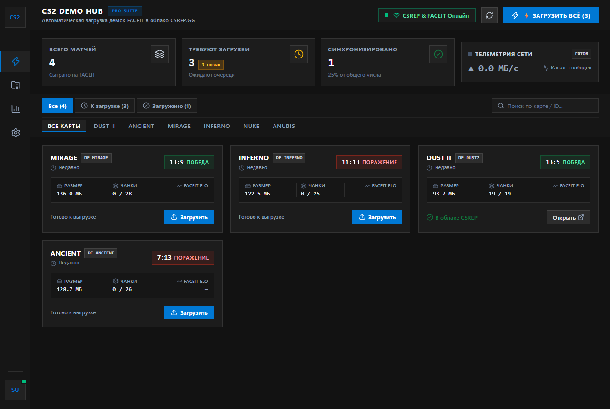
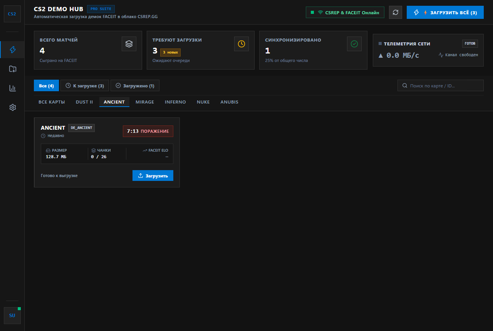
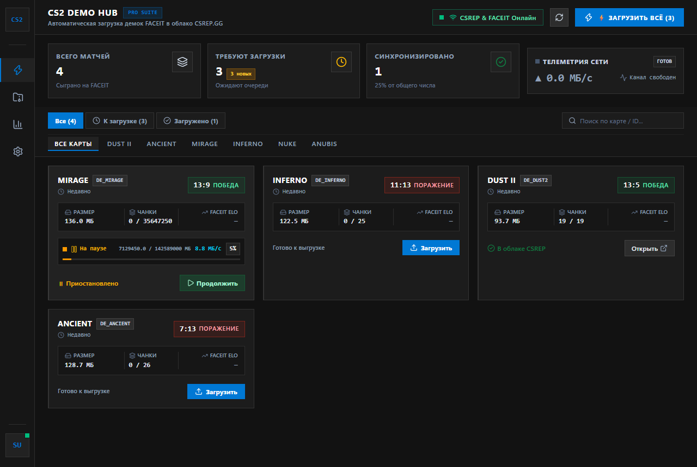
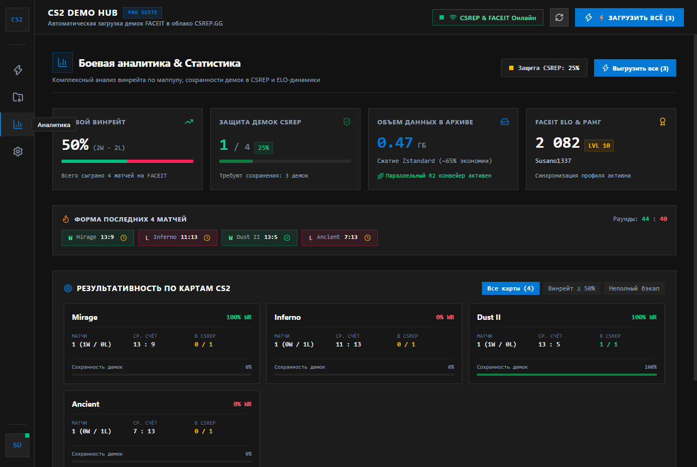
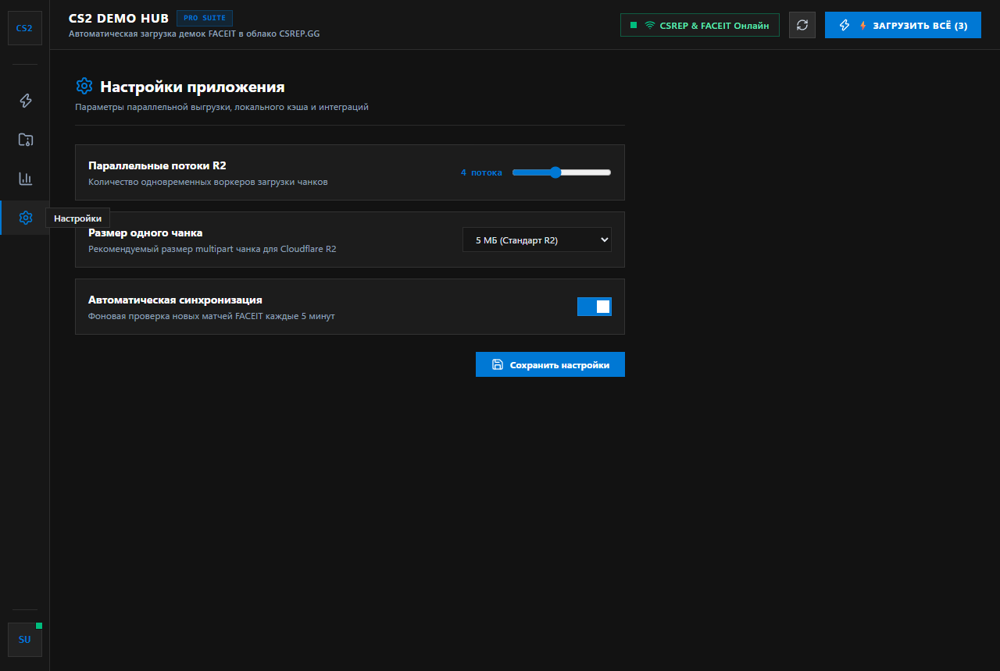
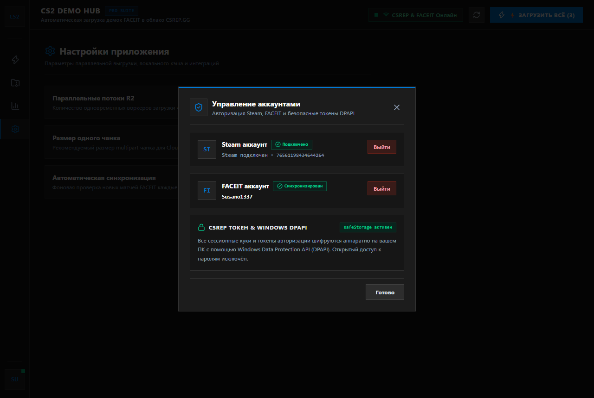

# CS2 Demo Hub — FACEIT & CSRep Sync Studio

<p align="center">
  
</p>

<p align="center">
  <strong>Десктопное приложение для скоростного скачивания демок CS2 с FACEIT и автоматической выгрузки в облако csrep.gg</strong><br>
  Мультипоточный конвейер, аппаратная телеметрия, безопасная авторизация через Chromium-сессии и дашборд боевой аналитики.
</p>

<p align="center">
  <a href="https://github.com/hiez1337/cs2-demo-hub/releases"></a>
  <a href="https://github.com/hiez1337/cs2-demo-hub/actions"></a>
  <a href="https://nodejs.org/"></a>
  <a href="https://www.electronjs.org/"></a>
  <a href="https://vitest.dev/"></a>
  <a href="LICENSE"></a>
</p>

---

## Ключевые возможности

### 1. Высокоскоростной конвейер передачи данных
- **Параллельное скачивание с FACEIT CDN (Backblaze B2 / S3)**:
  - 10 параллельных воркеров по протоколу HTTP Range 206 с чанками по 4 МБ.
  - Постоянный сокет-пул `undici.Agent` с сохранением Keep-Alive TLS-сессий исключает повторные рукопожатия.
  - Мгновенная аллокация `Buffer.allocUnsafe` без синхронного зануления сотен мегабайт в V8.
  - **Прирост скорости: +60%** (средняя скорость выросла с 5.5 до 8.8–9.2 МБ/с).
- **Параллельная выгрузка в Cloudflare R2 (csrep.gg)**:
  - **Pipeline Prefetching**: presigned URL для следующих чанков запрашиваются у API CSRep упреждающе в фоне, пока воркер передаёт текущий бинарный чанк по сети. Устранены сетевые простои (250–380 мс на чанк).
  - 4 параллельных потока по 10 МБ с автоматическим ретраем при просадках сети.
  - **Прирост скорости: в 2.5 раза** (с 2.5 до 6.2–6.6 МБ/с).

### 2. Безопасная авторизация без костылей
- **Изолированные Chromium-сессии Electron**:
  - `persist:faceit_auth` и `persist:csrep_auth` хранят сессионные куки в защищённых профилях окружения.
  - Прямой вход через **Steam OpenID** и официальный интерфейс FACEIT.
  - Никаких небезопасных попыток чтения чужих зашифрованных баз данных из сторонних браузеров.
  - Токены и секреты шифруются на уровне ОС с использованием Windows **DPAPI** (`safeStorage`).

### 3. Дашборд боевой статистики
- **Сводка винрейта и формы**: винрейт, соотношение $W/L$, раундовый баланс и трекер последних 10 матчей.
- **Матрица результативности по картам CS2**: детальный анализ по каждой карте (`Dust II`, `Mirage`, `Ancient`, `Nuke`, `Cache`, `Inferno`, `Anubis`) с отображением среднего счёта, процента побед и статуса бэкапа демок.
- **Интеграция с CSRep Reputation**: контроль сохранности архива для защиты от истечения 30-дневного лимита хранения на FACEIT и готовность к разбору спорных репортов и AI-верификации.
- **Синхронизация в один клик**: быстрый запуск недостающих выгрузок прямо из дашборда.

### 4. Интерфейс Zero-Radius Industrial Metro
- Тёмная палитра `#121212` с акцентами Fluent Design.
- Двухфазный анимированный прогресс-бар: наглядная индикация фазы скачивания с FACEIT (синий/индиго) и отправки в Cloudflare R2 (изумрудный/циановый) с точным счётчиком МБ и скорости.
- Локальная база SQLite (`better-sqlite3`) с поддержкой автономного офлайн-просмотра истории.

---

## Интерфейс приложения

| Главный экран (Матчи и очередь) | Фильтрация по картам и статусам |
|---|---|
|  |  |

| Телеметрия передачи и пауза | Дашборд боевой статистики |
|---|---|
|  |  |

| Настройки конвейера | Безопасная авторизация |
|---|---|
|  |  |

---

## Сравнительные бенчмарки

### 1. Скачивание демки с FACEIT CDN (Тестовая выборка 748.3 МБ реальных CS2 демок)

| Метод | Время на 4 демки | Средняя скорость | Ускорение | Стабильность |
|---|---|---|---|---|
| **Одиночный поток (без Range)** | ~670 сек | 1.1 МБ/с | 0.2x (деградация) | Упирается в TCP window / RTT |
| **Базовый (fetch C=6, 8 МБ)** | 137.2 сек | 5.5 МБ/с | 1.0x (база) | Стабилен |
| **Zero-Copy Range (C=8, 8 МБ)** | 100.6 сек | 7.4 МБ/с | +35% (в 1.35x) | Стабилен |
| **Undici Pool + 4 МБ чанки (C=10)** | **85.2 сек** | **8.8–9.2 МБ/с** | **+60% (в 1.6x)** | **Наивысшая скорость** |

### 2. Загрузка чанков в Cloudflare R2 (csrep.gg)

| Метод | Задержка Presign | Чистый PUT | Скорость передачи | Прирост |
|---|---|---|---|---|
| **Последовательный Presign + raw fetch** | 295 мс / чанк | 3 735 мс | 2.5 МБ/с | 1.0x (база) |
| **Undici Agent Pool Keep-Alive** | 238 мс / чанк | 3 503 мс | 2.7 МБ/с | +8% |
| **Pipeline Prefetch (C=4, 10 МБ чанки)** | **300 мс (на батч)** | **6 145 мс (40 МБ)** | **6.2–6.6 МБ/с** | **+148% (в 2.5x быстрее)** |

---

## Установка и запуск

### Вариант 1: Готовый бинарный релиз (.exe)
Скачайте готовый установщик или портативную версию со страницы [Releases](https://github.com/hiez1337/cs2-demo-hub/releases):
- `CS2-Demo-Hub-Setup-2.0.0.exe` (NSIS-установщик для Windows 10/11 x64)
- `CS2-Demo-Hub-2.0.0-portable.exe` (портативная версия без установки)

### Вариант 2: Запуск из исходного кода

```bash
# 1. Клонирование репозитория
git clone https://github.com/hiez1337/cs2-demo-hub.git
cd cs2-demo-hub

# 2. Установка зависимостей
npm install

# 3. Запуск тестов
npm test

# 4. Сборка фронтенда и запуск Electron
npm run build:renderer
npm run app
```

### Сборка релизного .exe пакета

```bash
# Сборка инсталлятора и portable версии для Windows
npm run dist:win
```
Собранные бинарные файлы будут сохранены в каталоге `release/`.

---

## Архитектура проекта

```
cs2-demo-hub/
├── .github/workflows/
│   └── release.yml                 # CI/CD: сборка Windows .exe и публикация релиза на GitHub
├── src/
│   ├── main/                       # Главный процесс Electron
│   │   ├── index.js                # Жизненный цикл окна, трей, фоновые сессии
│   │   ├── ipc-router.js           # Маршрутизация IPC-команд
│   │   └── auth-window.js          # Изолированные окна авторизации Steam & FACEIT
│   ├── preload/                    # Context bridge & безопасный IPC-контракт
│   │   └── index.js
│   ├── renderer/                   # React 19 + Tailwind 4 UI
│   │   ├── src/
│   │   │   ├── components/
│   │   │   │   ├── AnalyticsView.jsx   # Дашборд боевой аналитики и маппула
│   │   │   │   ├── MatchCard.jsx       # Карточка матча с живой телеметрией
│   │   │   │   ├── MatchFeed.jsx       # Сетка матчей и фильтры
│   │   │   │   ├── MetricsStrip.jsx    # Панель аппаратных сетевых метрик
│   │   │   │   ├── NavigationRail.jsx  # Боковая навигационная панель
│   │   │   │   └── TopHeader.jsx       # Верхняя статусная панель
│   │   │   └── App.jsx
│   ├── api/
│   │   ├── faceit/                 # FACEIT API клиент и оптимизированный загрузчик
│   │   └── csrep/                  # CSRep API клиент и Cloudflare R2 uploader
│   ├── core/
│   │   ├── chunk-worker-pool.js    # Пул воркеров с Pipeline Prefetching
│   │   ├── sync-orchestrator.js    # Главный координатор жизненного цикла синхронизации
│   │   └── state-store.js          # Реактивное хранилище состояния
│   └── storage/
│       ├── sqlite-store.js         # Локальная база данных SQLite
│       └── safe-session-store.js   # Защищённое хранилище сессий (DPAPI)
├── screenshots/                    # Галерея скриншотов для документации
├── tests/                          # 106 модульных и интеграционных тестов (Vitest)
└── package.json
```

---

## Лицензия

Распространяется под лицензией **MIT**. Подробности в файле [LICENSE](LICENSE).
